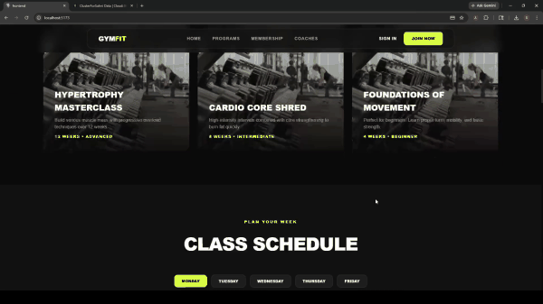

<div align="center">

# GymFitness

**Production-Grade Full-Stack MERN Architecture for Fitness Operations, Subscription Lifecycles & Scheduling**

[](https://gym-website-seven-eta.vercel.app)
[](docs/assets/walkthrough.mp4)
[](https://react.dev/)
[](https://expressjs.com/)
[](https://www.mongodb.com/)
[](https://jwt.io/)
[](LICENSE)

<br />

<!-- Responsive Media Showcase -->
<a href="docs/assets/walkthrough.mp4" target="_blank" rel="noopener noreferrer">
  
</a>

<p align="center">
  <sub>Live preview • <a href="docs/assets/walkthrough.mp4"><b>Watch Full 1080p Video Walkthrough (1:21)</b></a> • <a href="https://gym-website-seven-eta.vercel.app"><b>Open Production Deployment</b></a></sub>
</p>

</div>

---

## Overview

GymFitness is an end-to-end full-stack web application architected for modern athletic facilities, personal training studios, and gym networks.

The platform provides an integrated operating environment featuring client self-service portals, dynamic class scheduling, trainer booking pipelines, tier-based subscription management, and role-guarded administrative workflows. Built on a decoupled MERN (MongoDB, Express, React, Node.js) topology, the codebase emphasizes security, data consistency, and deterministic API design.

---

## System Architecture

```
                       ┌─────────────────────────┐
                       │  Client Application     │
                       │  (React 19 / Vite SPA)  │
                       └────────────┬────────────┘
                                    │
                         HTTPS / REST API (JSON)
                         with HTTP-only Cookies
                                    │
                                    ▼
┌────────────────────────────────────────────────────────────────────────┐
│                   Express.js Application Gateway                       │
│                                                                        │
│  ┌──────────────┐   ┌──────────────┐   ┌─────────────┐   ┌──────────┐  │
│  │ Rate Limiter │──▶│ Helmet (CSP) │──▶│ Compression │──▶│   CORS   │  │
│  └──────────────┘   └──────────────┘   └─────────────┘   └──────────┘  │
│                                                                        │
│  ┌───────────────────────┐             ┌─────────────────────────────┐ │
│  │ JWT Auth Middleware   │────────────▶│ Controllers & Route Handlers│ │
│  └───────────────────────┘             └──────────────┬──────────────┘ │
└───────────────────────────────────────────────────────┼────────────────┘
                                                        │
                                        Mongoose ODM Queries
                                                        │
                                                        ▼
                                         ┌─────────────────────────────┐
                                         │       MongoDB Cluster       │
                                         │  (Users, Plans, Bookings)   │
                                         └─────────────────────────────┘
```

---

## Engineering & Security Highlights

### 1. Authentication & Session Security
- **Stateless JWT Tokens with HTTP-Only Cookies**: Eliminates vulnerability to Cross-Site Scripting (XSS) token theft by storing credentials in secure, `SameSite=None` (production) and `SameSite=Lax` (development) cookies.
- **Cryptographic Hashing**: User credentials salted and hashed via `bcryptjs` with 10 work factor rounds prior to persistence.
- **Role-Based Access Control (RBAC)**: Declarative route guards (`protect` and `adminOnly` middleware) strictly isolate member resources from administrative management endpoints.

### 2. Resilience, Security Headers & Rate Limiting
- **Traffic Throttling**: IP-based rate limiting via `express-rate-limit` (100 requests per 15-minute window) mitigates distributed denial-of-service (DDoS) and brute-force authentication attacks.
- **Header Hardening**: `helmet` enforces Content Security Policy (CSP), HTTP Strict Transport Security (HSTS), and clickjacking prevention.
- **Bandwidth Optimization**: Gzip/Brotli payload compression through `compression` middleware reduces round-trip latency on data-heavy endpoints.

### 3. Payment Gateway Abstraction & Sandbox Fallback
- Integration with Razorpay API includes cryptographic HMAC-SHA256 signature verification for order validation.
- Implements an intelligent `IS_MOCK` design pattern: automatically switches to safe simulated transactions when keys are omitted, enabling frictionless local developer onboarding without external payment credentials.

### 4. Modern React 19 Frontend Engineering
- Single Page Application (SPA) powered by React 19 and Vite 8 for instant build cycles.
- Declarative layout animations orchestrated via Framer Motion.
- Centralized Axios client instance configured with credentials and environment-driven base URL resolution (`http://localhost:5000/api` local fallback).

---

## Database Schema & Data Models

| Model | Schema File | Core Fields & Relationships |
| :--- | :--- | :--- |
| **User** | `models/User.js` | `name`, `email` (unique index), `password` (hashed), `role` (`user` \| `admin`), timestamps |
| **Membership** | `models/Membership.js` | `title`, `price`, `duration`, `features` (array), `badge`, `popular` (boolean) |
| **Booking** | `models/Booking.js` | `user` (ref: User), `trainer` (ref: Trainer), `program` (ref: Program), `date`, `status` |
| **Trainer** | `models/Trainer.js` | `name`, `specialty`, `experience`, `rating`, `image`, `bio` |
| **Program** | `models/Program.js` | `title`, `category`, `duration`, `intensity`, `schedule`, `enrolled` |
| **Payment** | `models/Payment.js` | `user` (ref: User), `orderId`, `paymentId`, `amount`, `status`, `planName` |
| **Progress** | `models/Progress.js` | `user` (ref: User), `weight`, `bmi`, `workoutsCompleted`, `recordedAt` |

---

## API Specification

| Method | Endpoint | Access | Description |
| :--- | :--- | :--- | :--- |
| `POST` | `/api/auth/register` | Public | Create new member profile with credentials |
| `POST` | `/api/auth/login` | Public | Authenticate user & issue signed HTTP-only cookie |
| `POST` | `/api/auth/logout` | Protected | Invalidate session & clear authentication cookies |
| `GET` | `/api/auth/me` | Protected | Retrieve currently authenticated user context |
| `GET` | `/api/memberships` | Public | List all active membership subscription tiers |
| `POST` | `/api/memberships` | Admin | Create or update subscription specifications |
| `GET` | `/api/trainers` | Public | Retrieve directory of verified trainers |
| `GET` | `/api/programs` | Public | Query scheduled workout and fitness programs |
| `POST` | `/api/bookings` | Protected | Schedule a session with a trainer or class |
| `GET` | `/api/progress` | Protected | Fetch personal fitness telemetry and metrics |
| `POST` | `/api/payment/orders`| Protected | Initialize checkout session with payment gateway |
| `GET` | `/api/admin/metrics` | Admin | Retrieve administrative facility KPIs |

---

## Technology Stack

| Layer | Technology | Specification / Role |
| :--- | :--- | :--- |
| **Frontend** | React 19, Vite 8 | Modern component UI with Fast Refresh |
| **Styling & Motion** | Framer Motion, Styled Components | High-performance CSS-in-JS and fluid physics animations |
| **HTTP Client** | Axios | Typed HTTP client with cookie lifecycle management |
| **Server** | Node.js (v18+), Express 4 | High-throughput asynchronous REST application server |
| **Database** | MongoDB 8.x with Mongoose | Flexible document model with strict schema validation |
| **Security** | Helmet, bcryptjs, jsonwebtoken | Multi-layer defensive security suite |

---

## Project Structure

```
GymWebsite/
├── docs/
│   └── assets/              # Walkthrough media, GIF preview, and poster assets
├── backend/
│   ├── src/
│   │   ├── config/          # MongoDB connection initialization (db.js)
│   │   ├── controllers/     # Modular business logic for auth, bookings, payments
│   │   ├── middleware/      # Auth verification, RBAC guards, error handlers
│   │   ├── models/          # Mongoose schema definitions
│   │   ├── routes/          # Express route declarations
│   │   ├── seed.js          # Database seeding script for development
│   │   └── server.js        # Express server lifecycle & middleware pipeline
│   ├── .env.example         # Environment template for backend service
│   └── package.json
├── frontend/
│   ├── src/
│   │   ├── components/      # Modular layout components (Hero, Navbar, Schedules)
│   │   ├── context/         # React Context for global auth state management
│   │   ├── pages/           # View controllers (Dashboard, Admin, Trainers, Profile)
│   │   ├── api.js           # Centralized Axios client instance
│   │   └── main.jsx         # Application bootstrapping entrypoint
│   ├── .env.example         # Environment template for frontend client
│   └── package.json
└── README.md
```

---

## Installation & Setup

### Prerequisites
- Node.js (v18.0 or higher)
- MongoDB instance (Local or MongoDB Atlas URI)

### 1. Clone the Repository
```bash
git clone https://github.com/TrirpurariSahni/GymWebsite.git
cd GymWebsite
```

### 2. Backend Configuration & Startup
```bash
cd backend
npm install
cp .env.example .env
```
Populate `.env` with your configuration:
```env
PORT=5000
NODE_ENV=development
MONGO_URI=mongodb://localhost:27017/gymfitness
JWT_SECRET=your_secure_random_jwt_secret
CLIENT_URL=http://localhost:5173

# Optional: Razorpay Keys (Defaults to Mock Mode if omitted)
RAZORPAY_KEY_ID=your_razorpay_key_id
RAZORPAY_KEY_SECRET=your_razorpay_key_secret
```
Start the backend service:
```bash
npm run dev
```

### 3. Frontend Configuration & Startup
In a separate terminal window:
```bash
cd frontend
npm install
cp .env.example .env
npm run dev
```
The client dashboard will run at `http://localhost:5173` connecting deterministically to the API server at `http://localhost:5000`.

---

## Author & Contact

**Trirpurari Sahni** — Full-Stack Software Developer  
- **GitHub**: [@TrirpurariSahni](https://github.com/TrirpurariSahni)  
- **Email**: sahanitrirpurari@gmail.com  
- **Production URL**: [https://gym-website-seven-eta.vercel.app](https://gym-website-seven-eta.vercel.app)

---

## License

This project is licensed under the [MIT License](LICENSE).
